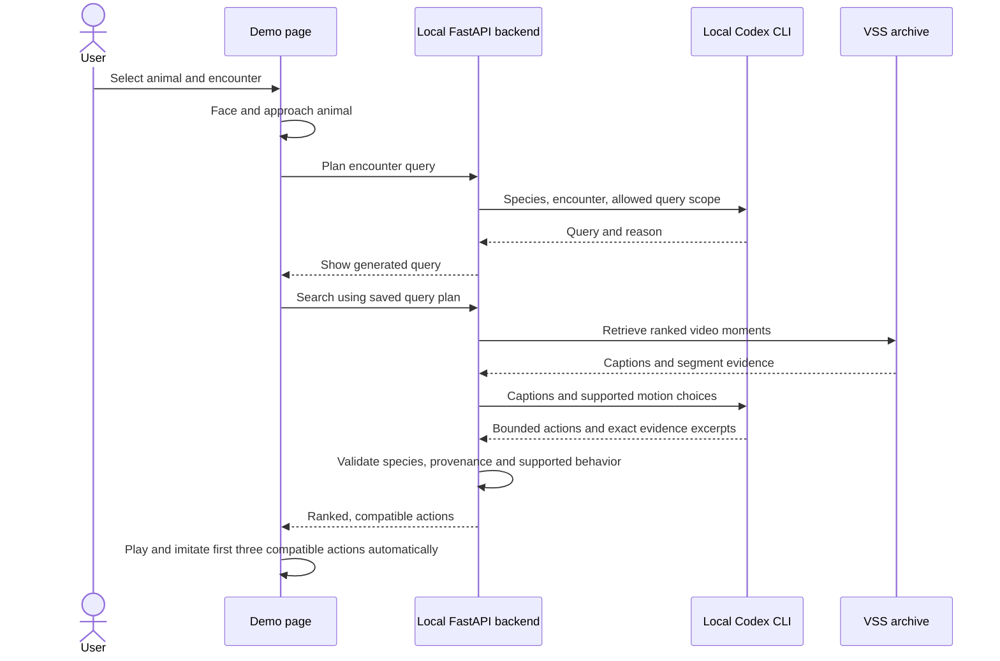

# VAST Builders Challenge: Video Agents

Build video agents on the deployed VSS stack using its search, metadata,
detections, and video APIs.

[Ranger Duck](apps/ranger-duck/README.md) combines a simulated wildlife encounter,
archive search, video evidence, and the existing Microduck movement policies in
one demo page.

## Ranger Duck tech stack

| Layer | Technology | Role |
| --- | --- | --- |
| Frontend | React 18, TypeScript, Vite | Encounter controls, search state, reference cards, and segment playback. |
| Simulation | Three.js, MuJoCo WebAssembly, ONNX Runtime Web, Zustand | Render Microduck, simulate physics, and run the existing movement policies in the browser. |
| Backend | Python 3.11+, FastAPI, Pydantic, HTTPX, Uvicorn | Validate requests, authenticate to VSS, normalize evidence, proxy video, and check action eligibility. |
| Search agent | Codex CLI through `codex exec`, using the presenter's local ChatGPT OAuth login | Generate search queries and choose caption-grounded, supported duck actions. |
| Archive | Existing deployed VSS APIs, backed by VastDB and S3 video storage | Retrieve indexed segments, captions, metadata, detections, and playable video. |
| Archive enrichment | Shared VAST DataEngine pipeline with Cosmos3-Reason, YOLO11, and Cosmos Embed1 | Produce searchable descriptions, detections, and embeddings before retrieval. |
| Session and evidence state | In-memory backend sessions, caption-based interaction rules, and an optional reviewed-reference JSON manifest | Scope clip access and replay; derive supported movements from segment evidence while distinguishing inference from human review. |
| Verification | pytest, Vitest, TypeScript build checks | Check backend contracts, frontend state behavior, and builds. |

Ranger Duck consumes the deployed archive through VSS APIs. It does not need a
new database or a replacement ingest pipeline. The shared model and storage
boundaries are described in the [architecture reference](docs/hackathon/ARCHITECTURE_REFERENCE.md).
Canary-1B is available in the workshop but is not part of this app's search flow.

## How agentic search works

Both demo modes use the local Codex CLI with the presenter's existing ChatGPT
OAuth login. The backend runs on the same Mac; no SSH agent bridge or copied
account credentials are needed. VSS search remains an authenticated request to
the configured archive service.

The agent searches for interactions between the selected species **or similar
individual behavior**. A returned clip need not contain two animals. Actions
must be supported by that clip's caption or an exact current human review;
the requested encounter cannot supply missing evidence. Eligible reference actions are walking, beak dip, vertical head nod and
sit/stand. `head_scan` and `stand_hold` are excluded in both modes. An active
behavior within a mixed caption can still qualify. Archive ordering is
preserved, and excluded clips do not occupy the three action slots.

The duck begins attending to the animal immediately, before search completes.
The controls show actual turning, walking and imitation commands. Navigation is
scene positioning, separate from video-derived imitation. Stop cancels pending
agent work and movement; switching clips does not reload the duck.

**Encounter mode** generates an initial query on demand, plans actions for the
returned candidates, and loops the first three compatible references. Replay
uses the saved decisions. **Agent Loop mode** generates its next query from the
prompt and actual previous playback/movement outcome, then chooses one clip
and a bounded response. See the [demo guide](apps/ranger-duck/README.md) and
[API contract](docs/RANGER_DUCK_API.md).

### Local ChatGPT OAuth

Run `codex login` on the same computer and OS account as the backend, then
`codex login status`. The application uses `codex exec` with ChatGPT sign-in;
no OpenAI API key is required. Codex manages its own OAuth credentials, which
the application neither reads nor sends to the browser. These requests consume
the presenter's Codex subscription allowance. See the official documentation for
[authentication](https://developers.openai.com/codex/auth) and
[non-interactive execution](https://developers.openai.com/codex/noninteractive).

Each decision uses an ephemeral, schema-constrained `gpt-6-luna` run with shell,
web, apps and other tools disabled. VSS credentials are removed from its
environment. The backend validates the output against the supplied evidence;
failed agent calls are explicit errors rather than silently fabricated actions.

For local setup, follow the [backend guide](apps/ranger-duck/backend/README.md).
Video search separately requires `INGRESS_URL`, `USERNAME` and `PASSWORD` in
the backend's ignored `.env` or environment. ChatGPT OAuth does not authenticate
the VSS archive. Keep the demo on loopback and keep secrets out of Git.

## Workshop documentation

Hackathon documentation lives in [`docs/hackathon/`](docs/hackathon/):

- [Build day guide](docs/hackathon/BUILD_DAY.md)
- [Submission requirements, judging criteria, and schedule](docs/SUBMISSION.md)
- [Before you build](docs/hackathon/BEFORE_YOU_BUILD.md)
- [Architecture reference](docs/hackathon/ARCHITECTURE_REFERENCE.md)
- [Infrastructure onboarding (PDF)](docs/hackathon/BUILDERS-CHALLENGE-INFRA-ONBOARDING.pdf)

For agent setup and workflows, see the [Codex setup and skill catalog](docs/CODEX.md),
[repository instructions](AGENTS.md), [Codex skills](.agents/skills/), and
[Cursor skills](.cursor/README.md). [`config.example`](config.example) documents
the environment variables used by the skills.

To connect from your laptop, follow the [service connection guide](docs/SERVICE_CONNECTIONS.md).
External video sources, licences, verification and ingestion status are tracked in
the [external video index](data/README.md). Dataset download and ingestion scripts
are in [`cronjob/ceda-soc250721`](cronjob/ceda-soc250721/README.md).
