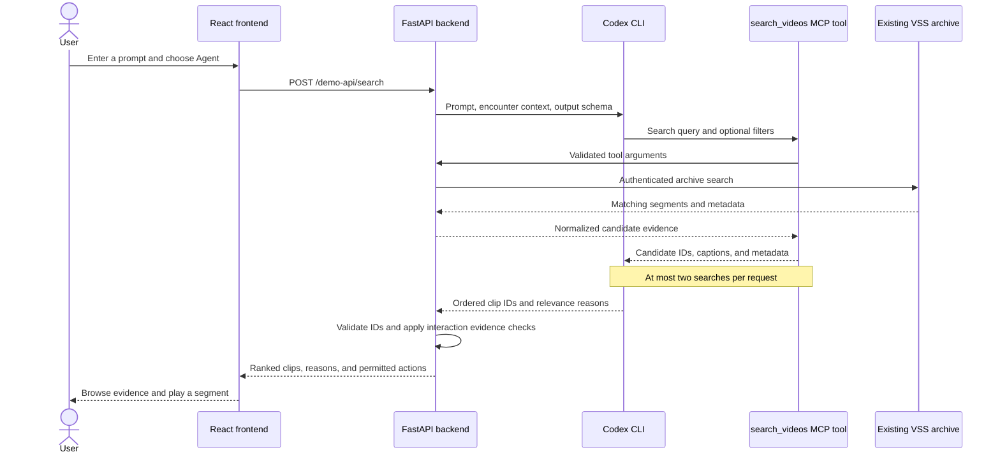

# VAST Builders Challenge: Video Agents

Build video agents on the deployed VSS stack using its search, metadata,
detections, and video APIs.

[Ranger Duck](apps/ranger-duck/README.md) combines a simulated wildlife encounter,
archive search, video evidence, and the existing Microduck movement policies in
one demo page.

## Ranger Duck tech stack

| Layer | Technology | Role |
| --- | --- | --- |
| Frontend | React 18, TypeScript, Vite | Encounter controls, search state, reference cards, and segment playback. |
| Simulation | Three.js, MuJoCo WebAssembly, ONNX Runtime Web, Zustand | Render Microduck, simulate physics, and run the existing movement policies in the browser. |
| Backend | Python 3.11+, FastAPI, Pydantic, HTTPX, Uvicorn | Validate requests, authenticate to VSS, normalize evidence, proxy video, and check action eligibility. |
| Search agent | Codex CLI through `codex exec`, using the presenter's existing ChatGPT login | Interpret a prompt, call archive search as a tool, and rerank retrieved clips. Integration status is below. |
| Agent tool bridge | MCP (Model Context Protocol), Python stdio server, private Unix socket | Expose a bounded `search_videos` tool backed by the application's VSS client. |
| Archive | Existing deployed VSS APIs, backed by VastDB and S3 video storage | Retrieve indexed segments, captions, metadata, detections, and playable video. |
| Archive enrichment | Shared VAST DataEngine pipeline with Cosmos3-Reason, YOLO11, and Cosmos Embed1 | Produce searchable descriptions, detections, and embeddings before retrieval. |
| Session and evidence state | In-memory backend sessions, caption-based interaction rules, and an optional reviewed-reference JSON manifest | Scope clip access and replay; derive supported movements from segment evidence while distinguishing inference from human review. |
| Verification | pytest, Vitest, TypeScript build checks | Check backend contracts, frontend state behavior, and builds. |

Ranger Duck consumes the deployed archive through VSS APIs. It does not need a
new database or a replacement ingest pipeline. The shared model and storage
boundaries are described in the [architecture reference](docs/hackathon/ARCHITECTURE_REFERENCE.md).
Canary-1B is available in the workshop but is not part of this app's search flow.

## How agentic search works

**Integration status:** encounter mode retains direct VSS search with Live and
Replay controls. The additional **Agent Loop mode** now uses Codex CLI structured
decisions to generate queries and choose supported responses; actual simulator
outcomes guide subsequent searches. See the [Loop mode guide](apps/ranger-duck/README.md#agent-loop-mode)
and [current API contract](docs/RANGER_DUCK_API.md#additional-agent-loop-mode).
The diagram and numbered flow below describe the earlier MCP search-agent
prototype. The new loop instead executes bounded retrieval in the backend between
Codex query and selection decisions; it does not use that prototype's MCP bridge.

1. **Understand the request.** The user can ask, for example, “Find a deer
   feeding, with its head clearly visible.” The backend supplies that prompt
   and the selected encounter to an isolated, ephemeral Codex run.
2. **Retrieve through a tool.** Codex calls `search_videos` with a query and
   optional metadata filters. The backend validates the arguments and filter
   values, then searches VSS within the configured user's access scope. The
   prototype allows two calls, up to 15 candidates per call, and a deduplicated
   pool of at most 30 clips, allowing one query refinement.
3. **Rerank the evidence.** Codex ranks the returned clips against the user's
   intent using captions, metadata, similarity, and available reviewed labels.
   It returns structured JSON containing clip IDs and concise relevance reasons.
   This is caption-and-metadata reranking: the agent does not watch video frames
   or establish that a behavior is visually confirmed.
4. **Validate and return.** The backend checks that a search actually occurred
   and that ranked IDs came from that request's results. Unknown or duplicate
   IDs and malformed output are rejected. The frontend receives the validated
   ordering and explanations alongside the existing playback and provenance
   fields.
5. **Keep movement tied to segment evidence.** The saved prototype required a
   human-reviewed reference before enabling Copy. The current demo instead
   derives supported actions from the returned video-model captions, requiring
   the selected species and complete provenance. Single-animal behavior is
   eligible. It filters incompatible results, then automatically plays and
   imitates the first three compatible actions in retrieval order. Agent integration must preserve those checks and distinguish
   inferred actions from human review; a reranking explanation alone cannot
   authorize movement. See the [interaction evidence rules](docs/RANGER_DUCK_INTERACTIONS.md).

### Existing Codex login, without an API key

The prototype starts `codex exec` as a backend subprocess. Codex reuses its saved
CLI authentication; our implementation requires ChatGPT sign-in and checks
availability with `codex login status`. No OpenAI API key is required for this
chosen path. See the official documentation for [non-interactive execution](https://developers.openai.com/codex/noninteractive)
and [authentication](https://developers.openai.com/codex/auth).

The machine and OS user running the backend must have a working Codex CLI login
and access to the configured VSS service. A laptop login does not automatically
authenticate a backend running on the workshop VM. Codex manages its own
credentials; the application does not read or copy its authentication file or
send tokens to the browser. VSS credentials remain in the backend and are excluded
from the Codex subprocess environment. This is a trusted presenter demo using
that account's Codex access and usage limits.

The agent's archive tool is exposed through a per-request private bridge. The
prototype disables unrelated tools, validates the final output against a JSON
schema and the actual retrieved candidates, and bounds execution time. A failed
agent run returns an explicit error; it does not silently switch to direct
search or replay. Model selection is configurable; the recorded prototype tests
used the Codex CLI default rather than a pinned model.

### Connecting the new frontend

The integration will extend the existing `/demo-api/search` route:

| Concern | Planned change |
| --- | --- |
| Search controls | Add Direct / Agent selection and an editable prompt prefilled from the encounter. Keep Live / Replay as a separate choice. |
| Request | Add `search_strategy: "direct" \| "agent"` and `prompt`, preserving `encounter_id`, `scenario_id`, `mode`, and `broaden`. These new fields are not accepted by the current API yet. |
| Response | Return executed queries, retrieval counts, ranking details, and each candidate's relevance reason. Preserve review status, provenance, and action fields. |
| Result cards and loop | Preserve the agent's ranking and display “Why this matches” separately from interaction evidence, human review, and retrieval similarity. Filter validated results for compatible actions, then feed the first three into the loop while displaying original source ranks. |
| Availability and timing | Advertise agent readiness and its timeout through health; let the browser wait for that budget plus connection grace. Reconcile the prototype deadline with the current VSS search budget. |
| Cancellation | Reuse the existing abort and request-generation handling when an encounter, prompt, or strategy changes. |
| Replay | Include strategy and prompt in the replay key, alongside encounter scope. Save ranking and reasons; recheck current interaction eligibility and review status on replay without another Codex call. |

Implementation entry points are [frontend search state](apps/ranger-duck/frontend/src/App.tsx),
[frontend API types](apps/ranger-duck/frontend/src/api.ts),
[backend routes](apps/ranger-duck/backend/ranger_duck/app.py), and
[session snapshots](apps/ranger-duck/backend/ranger_duck/session.py).
The [current API contract](docs/RANGER_DUCK_API.md) documents the working direct
path; the additions above remain planned until the agent is integrated.

### Prototype validation and latency

The saved prototype was tested with real Codex CLI execution and its existing
ChatGPT login, using fabricated VSS responses. Feeding and standing prompts
selected their intended clips through actual MCP tool calls. Six sequential
profile runs with Codex CLI 0.160.0 took **7.87–13.40 seconds**, with a **9.70-second
median**. These timings include agent execution and tool handling, but not live
archive latency. They do not establish improved ranking quality on real footage;
live retrieval and relevance evaluation remain integration checks.

For local development continuity, the prototype, tests, and profiling report are
preserved in local Git stash `4c4132bcd7db5f13c6600efe37948a7f109282e5`
(`ranger-duck-codex-agent-before-main-8fe7929`). A fresh clone will not contain that
stash. Port the agent and MCP bridge selectively into the current backend so the
new replay, video proxy, and timeout behavior are retained.

## Workshop documentation

Hackathon documentation lives in [`docs/hackathon/`](docs/hackathon/):

- [Build day guide](docs/hackathon/BUILD_DAY.md)
- [Submission requirements, judging criteria, and schedule](docs/SUBMISSION.md)
- [Before you build](docs/hackathon/BEFORE_YOU_BUILD.md)
- [Architecture reference](docs/hackathon/ARCHITECTURE_REFERENCE.md)
- [Infrastructure onboarding (PDF)](docs/hackathon/BUILDERS-CHALLENGE-INFRA-ONBOARDING.pdf)

For agent setup and workflows, see the [Codex setup and skill catalog](docs/CODEX.md),
[repository instructions](AGENTS.md), [Codex skills](.agents/skills/), and
[Cursor skills](.cursor/README.md). [`config.example`](config.example) documents
the environment variables used by the skills.

To connect from your laptop, follow the [service connection guide](docs/SERVICE_CONNECTIONS.md).
External video sources, licences, verification and ingestion status are tracked in
the [external video index](data/README.md). Dataset download and ingestion scripts
are in [`cronjob/ceda-soc250721`](cronjob/ceda-soc250721/README.md).
